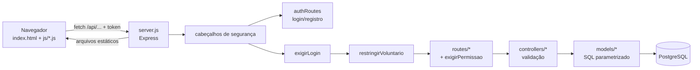

# Arquitetura

[← Voltar ao README](../README.md)

## Visão geral

O mesmo servidor entrega o frontend (pasta `frontend/`, arquivos estáticos) e a API (`/api/...`).

## Backend (MVC)

Cada área tem três arquivos com o mesmo nome base:

| Camada | Pasta | Responsabilidade | Exemplo |
|---|---|---|---|
| Rota | `backend/src/routes/` | Endereço, método HTTP e permissão exigida | `router.get('/voluntarios/:id', gestao, controller.getFicha)` |
| Controller | `backend/src/controllers/` | Ler e **validar** a entrada, chamar o model, montar a resposta e os códigos HTTP | `voluntariosController.getFicha` |
| Model | `backend/src/models/` | SQL (sempre com parâmetros `$1, $2…`), transações. `pessoasModel` concentra a base universal de pessoas: o único jeito de criar uma pessoa e os critérios de cada setor (menor de 18, voluntário elegível) | `voluntariosModel.buscarFicha`, `pessoasModel.criar` |

Apoio em `backend/src/config/`:

| Arquivo | Para quê |
|---|---|
| `db.js` | Pool de conexões do PostgreSQL (lê `backend/src/.env`) |
| `seguranca.js` | Hash de senha (scrypt) e token assinado (HMAC-SHA256) |
| `limiteLogin.js` | Bloqueio temporário após muitas tentativas de login |
| `erros.js` | `responderErro(res, error)`: traduz erros do banco em mensagens amigáveis, sem detalhes internos |
| `backup.js` | Executa o `pg_dump` e grava em `backups/` |
| `regrasVoluntario.js` | Validações compartilhadas entre a ficha e o portal (ausência, resposta à escala, disponibilidade) |

Middlewares em `backend/src/middlewares/autenticacao.js`:

- `exigirLogin` — valida o token, recarrega o usuário do banco (usuário desativado perde o acesso na hora) e guarda em `req.usuario`.
- `restringirVoluntario` — perfil Voluntário só acessa `/auth/me` e `/portal/*`.
- `exigirPermissao(area)` — administrador sempre passa; os demais precisam da área marcada em `usuarios.permissoes`.
- `exigirPerfil(...perfis)` — usado em Configurações (só administrador altera).

### Convenções do backend

- **Toda consulta usa parâmetros** (`pool.query(sql, [valores])`). Nunca concatene valores no SQL. Nos relatórios, os filtros são montados por um construtor que só gera `$n` (`relatoriosModel.js`).
- **Valide no controller** antes de chamar o model: tipos, formatos (`AAAA-MM-DD`, `HH:MM`), listas permitidas. IDs da URL passam por `Number.isInteger`.
- **Erros:** códigos esperados (409 duplicado, 404 não encontrado, 400 inválido) são tratados no controller; o resto vai para `responderErro(res, error)`. Nunca devolva `error.message` do banco ao cliente.
- **Operações com várias tabelas** usam transação (`pool.connect()` + `BEGIN/COMMIT/ROLLBACK`), como em `criarMembro`, `criar` (escalas) e `atualizar` (voluntário).
- **Portal:** o id do voluntário vem sempre de `req.usuario.id_membro`, nunca da URL ou do corpo.

## Frontend (página única)

`frontend/index.html` carrega os scripts e tem só `
`. Tudo é desenhado por JavaScript.

| Arquivo | Conteúdo |
|---|---|
| `js/script.js` | Núcleo: sessão, `buscarDados`/`enviarDados`, **rotas e histórico**, menu lateral, cabeçalho, utilitários, Dashboard, Eventos e Lista de presença |
| `js/menu.js` | Abre/fecha o menu lateral no celular |
| `js/login.js` | Tela de login e registro |
| `js/participantes.js`, `voluntarios.js`, `funcoes.js`, `escalas.js`, `criancas.js`, `usuarios.js`, `configuracoes.js`, `relatorios.js` | Uma área cada |
| `js/voluntario.js` | Ficha do voluntário + utilitários usados também pelo portal |
| `js/portal.js` | Minha área: escalas do voluntário (portal) ou próximos eventos para membros e visitantes |

Os arquivos de área são carregados **antes** do `script.js`, que dá a partida (`carregarDashboard()`).

### Como uma página funciona

Cada página é uma função assíncrona que:

1. registra a rota no histórico (`registrarRota('participantes')`) — **sempre na primeira linha**, antes de qualquer `await`;
2. marca o item do menu (`marcarMenuAtivo('gerenciaParticipantes')`);
3. busca os dados (`buscarDados('participantes', padrao)`);
4. monta os elementos e troca o conteúdo de `#main` com `main.replaceChildren(...)`;
5. liga os eventos (cliques, formulários).

### Rotas e botões Voltar/Avançar

`script.js` mantém a tabela `ROTAS` (`'participantes': [gerenciaParticipantes, 'participantes']` = função da página + permissão necessária + rota de volta opcional). O endereço fica em `#/rota` e o estado em `history.state` (`{ rota, args, anterior }`).

- **Abrir uma página** → `pushState`; abrir a mesma página de novo → `replaceState`.
- **Voltar/Avançar** → evento `popstate` reabre a página com os mesmos argumentos (`abrirRotaDoHistorico`).
- **Recarregar (F5)** → `history.state` sobrevive; a página atual é reaberta.
- **Sair de formulário** (salvar, cancelar, botão voltar) → use `abrirSubstituindo(gerenciaX)`: se o formulário veio da lista, faz `history.back()`; senão substitui a entrada. Assim o "voltar" não reabre um formulário já enviado.
- **Rota sem permissão** → Dashboard; **perfil Voluntário** → sempre Minha área.

### Utilitários do núcleo (`script.js`)

| Função | Para quê |
|---|---|
| `buscarDados(rota, padrao)` | GET com token; em erro devolve `padrao`; 401 leva ao login |
| `enviarDados(rota, metodo, corpo)` | POST/PUT/PATCH/DELETE com token; lança `Error` com a mensagem da API |
| `escapar(texto)` | **Obrigatório** em todo texto vindo do banco dentro de `innerHTML` (evita XSS) |
| `temPermissao(area)` | Mostra/esconde partes da tela conforme o usuário |
| `headerInterno(titulo, descricao)` / `headerComVoltar(...)` | Cabeçalho padrão das páginas |
| `cardsEstatisticas([[cor, icone, valor, rotulo], ...])` | Linha de cards de totais |
| `configurarFiltros(container, corresponde, { exigirInteracao })` | Busca + botões de filtro de tabelas. Com `exigirInteracao`, as linhas só aparecem após busca ou clique em filtro (Participantes, Voluntários, Funções, Crianças) |
| `abrirModal(titulo, descricao, html)` | Janela modal; devolve `{ modal, fechar }` |
| `mensagemFormulario(form, texto, erro)` | Mensagem abaixo do formulário |
| `formatarDataSimples`, `formatarHora`, `dataDeHoje`, `nomesDosDias` | Datas e horários |

## Passo a passo: criar uma página nova

Exemplo: uma página "Departamentos".

**Backend**

1. `backend/src/models/departamentosModel.js` — consultas com parâmetros.
2. `backend/src/controllers/departamentosController.js` — validações e respostas; use `responderErro` no `catch`.
3. `backend/src/routes/departamentosRoutes.js` — rotas com `exigirPermissao('voluntarios')` (ou a área adequada).
4. Em `server.js`, `app.use('/api', departamentosRoutes)` **depois** de `exigirLogin` e `restringirVoluntario`.
5. Se precisar de tabela/coluna nova, crie um `.sql` em `backend/database/` (só `CREATE ... IF NOT EXISTS` / `ADD COLUMN IF NOT EXISTS`) e um script `db:...` no `package.json`.

**Frontend**

6. `frontend/js/departamentos.js` com `async function gerenciaDepartamentos() { registrarRota('departamentos'); marcarMenuAtivo('gerenciaDepartamentos'); ... }`.
7. Inclua o `<script>` em `index.html` **antes** de `script.js`.
8. Em `script.js`: adicione a rota em `ROTAS` e o item na lista `paginas` de `sideBar()` (id, ícone do Material Icons, nome, função, permissão).
9. Use as classes existentes (`panel`, `cards`, `table-responsive`, `form-grid`, `checkbox-card`…) para manter o padrão visual e a responsividade.

**Testes**

10. Acrescente testes de permissão (rota sem login → 401, sem permissão → 403), de validação (400) e, se tiver tela, um teste em `tests/layout.test.js`. Veja [Testes](testes.md).

## Estilos

`frontend/css/style.css` é único, organizado por seções (estrutura, sidebar, topbar, cards, tabelas, formulários, páginas, login, ficha/portal) com as cores em variáveis no `:root` (`--navy` é o terracota da marca). Pontos de quebra: **1200px** (cards 2 colunas), **1024px** (menu vira gaveta), **700px** (celular: formulários em 1 coluna), **420px** (telas pequenas).
