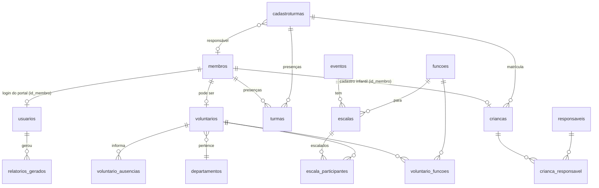

# Banco de dados

[← Voltar ao README](../README.md)

PostgreSQL, esquema `public`, codificação UTF-8. O esquema base veio do dump `dump-igreja_sistema-202610060830.sql`; as tabelas e colunas novas vêm das migrações em `backend/database/`.

## Relacionamentos principais



## Tabelas por área

### Pessoas

| Tabela | Descrição | Colunas importantes |
|---|---|---|
| `membros` | Membros da igreja (inclui crianças cadastradas como membros) | `nome_completo`, `data_nascimento`, `telefone`, `email`, `endereco`, `estado_civil`, `data_entrada_igreja`, `informacoes_batismo`, `ativo`, `apto_voluntario`, `voluntario`, `participa_celula`, `observacoes` |
| `visitantes` | Visitantes | `nome`, `telefone`, `data_visita`, `observacoes` |

### Voluntariado e escalas

| Tabela | Descrição | Colunas importantes |
|---|---|---|
| `voluntarios` | Membro que serve como voluntário | `id_membro`, `id_departamento`, `data_inicio_voluntariado`, `data_batismo`, `numero_mes_batizado` (mês do batismo, 1–12), `ativo`, `disponibilidade` (`varchar[]`: `domingo`, `segunda`…`sabado`), `observacoes` (internas — não aparecem no portal) |
| `departamentos` | Recepção, Louvor, Kids, Mídia, Estacionamento, Integração | `nome` (único), `descricao`, `ativo` |
| `funcoes` | Funções exercidas nas escalas | `nome` (único), `descricao`, `ativo`, `qtd_voluntarios` (**por escala**), `vagas` (tamanho desejado da equipe), `dias_disponiveis` (`varchar[]`), `observacoes` |
| `voluntario_funcoes` | Funções de cada voluntário (N:N) | PK (`id_voluntario`, `id_funcao`) |
| `eventos` | Cultos, reuniões e eventos | `nome`, `data_evento`, `hora_inicio`, `hora_fim`, `tipo_evento` (`culto`, `culto-jovens`, `culto-infantil`, `evento`, `reuniao`) |
| `escalas` | Uma função dentro de um evento | `id_evento`, `id_funcao`, `qtd_voluntarios`, `data_escala`, `horario` (chegada da equipe), `descricao`, `observacoes` |
| `escala_participantes` | Voluntários escalados | PK (`id_escala`, `id_voluntario`, `id_funcao`), `confirmado`, `recusado`, `motivo_recusa`, `respondido_em` |
| `voluntario_ausencias` | Períodos em que o voluntário não pode ser escalado | `id_voluntario`, `data_inicio`, `data_fim` (≥ início), `motivo` |

**Situação de um voluntário na escala:**

| Situação | `confirmado` | `recusado` |
|---|---|---|
| Aguardando resposta | `false` | `false` |
| Confirmado (ou presente, se já passou) | `true` | `false` |
| Recusou (com `motivo_recusa`) | `false` | `true` |
| Ausente (escala passada sem confirmação) | `false` | `false` e `data_escala < hoje` |

### Ministério infantil e presença

| Tabela | Descrição | Colunas importantes |
|---|---|---|
| `cadastroturmas` | Turmas (Kids 2–4, Kids 5–8, Next, Adolescentes…) | `nome` (único), `idade_minima`, `idade_maxima`, `id_membro_responsavel`, `dia_semana`, `horario`, `ativo` |
| `turmas` | **Registros de presença** (o nome é histórico) | `id_turma`, `id_membro`, `nome`, `data`, `hora_entrada`, `hora_saida`; único (`id_turma`, `id_membro`, `data`) |
| `criancas` | Cadastro infantil | `nome_completo`, `data_nascimento`, `id_membro` (para a presença), `id_turma`, `sexo`, `alergias`, `data_cadastro`, `autorizacao_responsavel`, `autorizacao_imagem`, `ativo` |
| `responsaveis` | Pais/responsáveis | `nome_completo`, `telefone`, `email`, `parentesco` |
| `crianca_responsavel` | Responsáveis de cada criança (N:N) | `responsavel_principal` |

> A "presença de hoje" de uma criança é um registro em `turmas` para o `id_membro` dela na data atual. Por isso, ao cadastrar uma criança, o sistema também cria um membro.

### Sistema

| Tabela | Descrição | Colunas importantes |
|---|---|---|
| `usuarios` | Logins | `nome`, `email` (único), `telefone`, `senha_hash` (`scrypt$sal$hash`), `perfil`, `ativo`, `permissoes` (JSON por área), `ultimo_acesso`, `observacoes`, `id_membro` (único quando preenchido — liga ao portal) |
| `configuracoes_igreja` | Dados da igreja (1 linha) | `nome_igreja`, `cnpj`, `telefone`, `endereco`, `cidade`, `estado`, `horario_principal`, `fuso_horario`, `notificacoes`, `notificacoes_email`, `ultimo_backup`, `proximo_backup` |
| `relatorios_gerados` | Histórico de relatórios | `tipo`, `data_inicial`, `data_final`, `formato` (`pdf`/`excel`/`csv`), `filtros` (JSON), `total_registros`, `id_usuario`, `gerado_em` |

**Perfis** (`usuarios.perfil`): `ADMINISTRADOR`, `GESTOR`, `SECRETARIA`, `FINANCEIRO`, `VOLUNTARIO`, `VISUALIZACAO`.
**Permissões** (`usuarios.permissoes`): `{ "participantes", "voluntarios", "escalas", "criancas", "relatorios", "usuarios" }` com `true/false`. Veja [Segurança](seguranca.md).

### Financeiro (sem tela ainda)

As tabelas existem no banco e o seed as preenche, mas o sistema ainda não tem páginas para elas:

| Tabela | Descrição |
|---|---|
| `categorias_financeiras` | Categorias de `RECEITA`/`DESPESA` (Dízimos, Ofertas, Energia, Pessoal…) |
| `fornecedores` | Fornecedores |
| `contas` | Contas a `PAGAR`/`RECEBER`, `status` `PAGO`/`PENDENTE` |
| `movimentacoes_financeiras` | Entradas e saídas (ligadas à conta quando houver) |
| `documentos_financeiros` | Boletos, notas, recibos |

### Views

| View | Usada em |
|---|---|
| `vw_dashboard` | Cards do Dashboard |
| `vw_resumo_pessoas` | Cards de Participantes |
| `vw_voluntarios_disponiveis` | Membros aptos ainda não marcados como voluntários (formulário de Eventos e card de Voluntários) |
| `vw_escalas_semana` | Legado — o Dashboard agora consulta as tabelas diretamente para considerar recusas |

## Migrações

Ficam em `backend/database/` e são executadas por `executar.js` (sempre em UTF-8, pela mesma conexão do `.env`). Todas são idempotentes.

| Script | Arquivo | O que cria/altera |
|---|---|---|
| `npm run db:presenca` | `presenca.sql` | `cadastroturmas`, `turmas` (presença) e 3 turmas iniciais |
| `npm run db:paginas` | `paginas.sql` | Colunas novas em `membros`, `voluntarios`, `funcoes`, `cadastroturmas`, `criancas`, `usuarios`; novos perfis; permissões padrão; `relatorios_gerados`; índices |
| `npm run db:voluntario` | `voluntario.sql` | `usuarios.id_membro`, colunas de recusa em `escala_participantes`, `voluntario_ausencias` |

Para rodar um `.sql` avulso:

```bash
node backend/database/executar.js backend/database/arquivo.sql
```

## Seeds (dados de teste)

| Arquivo | O que gera |
|---|---|
| `seed.js` | ~6 meses de histórico e ~2 meses de agenda, relativos à data da execução: 176 membros em famílias, visitantes, 64 voluntários, eventos, ~940 escalas, presenças, crianças e responsáveis, financeiro completo e 4 usuários. Corrige textos com codificação quebrada. Roda em transação única e não roda duas vezes |
| `seed-paginas.sql` | Preenche as colunas novas a partir dos dados existentes (turma pela idade, disponibilidade pelos dias em que serviu, vagas, histórico de relatórios) |
| `seed-voluntarios.js` | 3 logins do portal (`voluntario1..3@novocaminho.org`), 3 recusas e 3 ausências |

Todos usam a senha de teste `Teste@123`. **Não rode os seeds em produção.**

## Backups

- **Manual:** Configurações → Backup → *Executar agora* (só administrador).
- **Automático:** o servidor verifica a cada 15 minutos e, ao passar de `proximo_backup`, gera o backup e agenda o próximo para o dia seguinte às 03:00.
- Os arquivos ficam em `backups/backup-AAAAMMDD-HHMMSS.dump` (fora do git). Para restaurar, veja [Instalação](instalacao.md#restaurar-um-backup).

## Particularidades

- `escalas` tem **duas** chaves estrangeiras para `eventos` (uma com `ON DELETE CASCADE` e outra sem). Para apagar um evento, apague antes as escalas dele.
- `membros.voluntario` é uma marca antiga usada pela view `vw_voluntarios_disponiveis`; quem é voluntário de fato está na tabela `voluntarios`.
- Datas sem horário (`date`) chegam ao navegador como `AAAA-MM-DDT03:00:00Z` (meia-noite de Brasília). O frontend usa `formatarDataSimples`, que lê só os 10 primeiros caracteres.
- Funções antigas de teste ("Gari", "Garia", "Gariaaa") continuam no banco; podem ser inativadas na página Funções.
